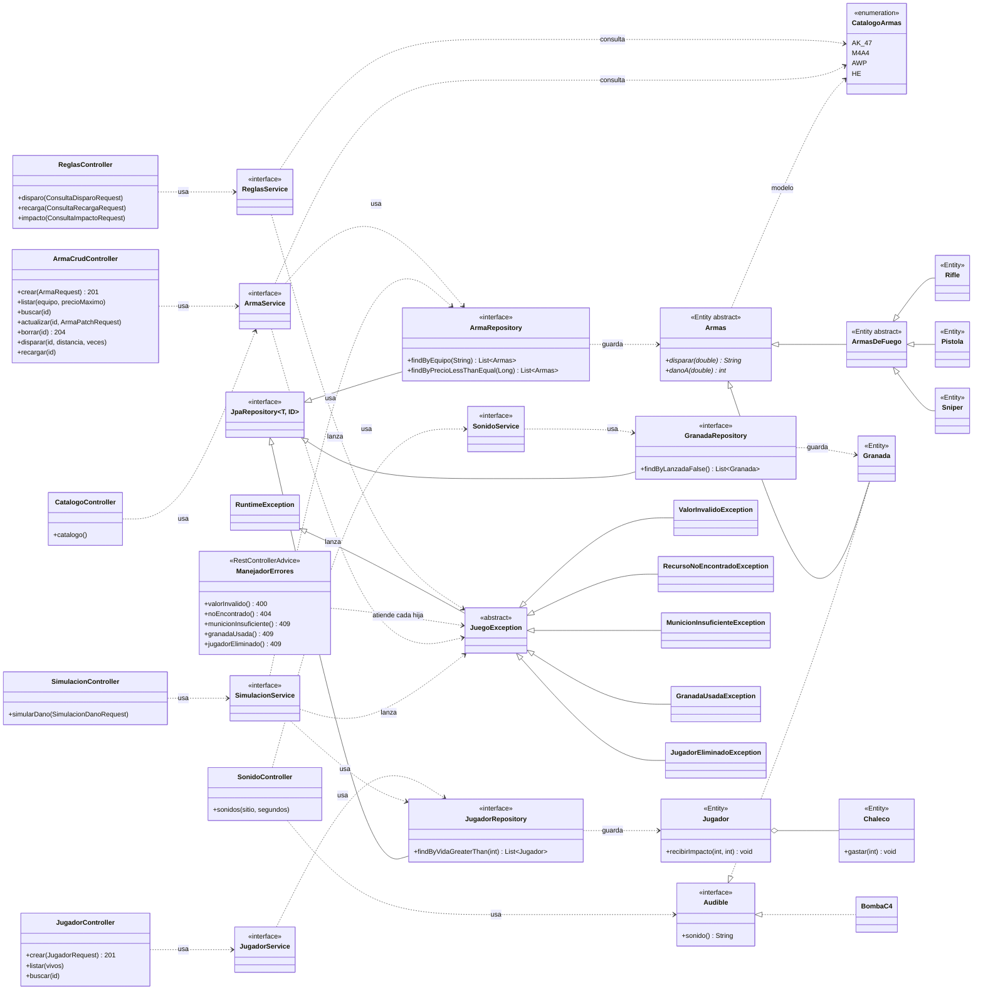
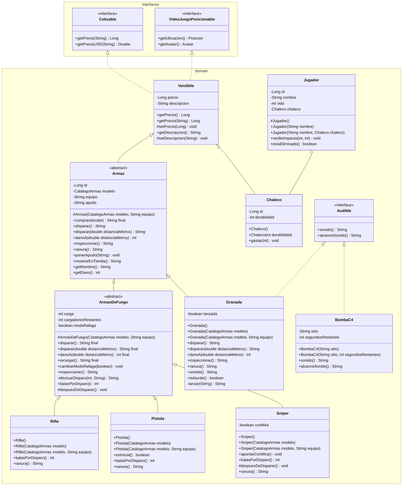

# MK-taller-git-2026 — Modelado de armas de CS2 con Spring Boot (Marcelo Kropff Y43819)

Trabajos prácticos POO-08 (CRUD REST, H2, reglas de juego y excepciones) y POO-09 (APIs cruzadas) de
Lenguaje de Programación 3, construidos sobre los ejercicios POO-06 e interfaces. Es un servicio HTTP en Spring Boot sobre el modelado
de Counter-Strike 2 (opción B), con herencia, sobreescritura, sobrecarga, ocultamiento de información y
paquetes según el template de la cátedra. Las armas, los jugadores y sus chalecos se guardan en una base
**H2**. Solo se pueden crear armas que existen en el juego, con sus valores reales.

- Enunciados: [POO-06](https://github.com/alefq/afq-taller-git-2024/blob/main/docs/ejercicio-poo-06-revision-paquetes-constructores-2026-09-30.md) · [POO-08](https://github.com/alefq/afq-taller-git-2024/blob/main/docs/ejercicio-poo-08-crud-h2-insomnia-2026-10-28.md) · [POO-09](https://github.com/alefq/afq-taller-git-2024/blob/main/docs/ejercicio-poo-09-apis-cruzadas-2026-11-16.md)
- Para los compañeros del grupo de POO-09: [docs/PARA-COMPANEROS.md](docs/PARA-COMPANEROS.md)
- Bitácora de IA: [BITACORA.md](BITACORA.md)
- Especificaciones aplicadas a CS2: [POO-08](docs/ESPECIFICACIONES-POO-08.md) · [POO-06](docs/ESPECIFICACIONES.md)
- Colección de Insomnia: [`insomnia/coleccion-armas-cs2.json`](insomnia/coleccion-armas-cs2.json)
- Enlace al commit de la corrección de POO-08: https://github.com/Pomona06/MK-taller-git-2026/commit/4198ec615bf7dd930a3b04c835b04f962877418d
- Enlace al commit entregado de POO-08 (antes de la corrección): https://github.com/Pomona06/MK-taller-git-2026/commit/e1f5309ec85711a4ed4cf5b854950a821bed5858
- Enlace al commit de la solución POO-06: https://github.com/Pomona06/MK-taller-git-2026/commit/e7a1c2019b316689e0d4b630e5aee0edf2a06bf2

## Licencia

Apache License 2.0. El texto completo está en [LICENSE](LICENSE).

## Cómo correr

Requiere Java 21.

```bash
./mvnw spring-boot:run
```

Queda escuchando en http://localhost:8080 (`GET /` confirma que está vivo). La primera vez, Maven
descarga las dependencias y tarda un poco. Los tests se corren con `./mvnw test`.

Si tenés una base de una versión anterior en la carpeta `data/`, frená el servicio y borrá esa carpeta: las
tablas cambiaron.

## POO-09: APIs cruzadas (en curso)

**Hecho:** la corrección de POO-08 (ver [Situación de POO-08](#situación-de-poo-08)), el OpenAPI publicado y la
consulta de las dos reglas sin tocar la base, para que los compañeros del grupo las usen.
**Pendiente:** armar el grupo (A2 y A3), los clientes HTTP hacia sus APIs, el endpoint de escenario y su
colección de Insomnia.

### OpenAPI

El servicio publica un documento OpenAPI 3 con [springdoc-openapi](https://springdoc.org/) (dependencia
`springdoc-openapi-starter-webmvc-ui` 3.2.0, la versión para Spring Boot 4.1):

| URL | Qué es |
|---|---|
| http://localhost:8080/v3/api-docs | El documento OpenAPI en JSON: se importa en Insomnia (**Import** → **URL**) o se le pasa a un cliente. |
| http://localhost:8080/swagger-ui.html | La misma documentación en el navegador, con **Try it out** para probar cada operación. |

Las propiedades están en `src/main/resources/application.properties`:

| Propiedad | Qué hace |
|---|---|
| `springdoc.api-docs.path=/v3/api-docs` | Dónde se publica el documento JSON. |
| `springdoc.swagger-ui.path=/swagger-ui.html` | Dónde se publica la página para probarlo. |
| `springdoc.api-docs.version=openapi_3_0` | Publica el documento en OpenAPI 3.0, la versión que importan más herramientas. |
| `springdoc.override-with-generic-response=false` | Cada operación documenta solo sus propios errores, no los de todos los handlers. |
| `springdoc.default-produces-media-type=application/json` | Las respuestas se documentan como JSON. |

La descripción general del documento (`OpenApiConfig`) explica las dos reglas, cómo consultarlas desde otro
servicio y el formato de error. Cada operación tiene un resumen, sus parámetros, ejemplos de cuerpo y los
códigos de error que puede devolver, con el tipo de excepción: el CRUD de armas, los jugadores, la
simulación, los sonidos, el catálogo y las consultas de reglas. El documento pasa la validación de
`openapi-spec-validator`.

### Mis reglas, para el grupo

Las dos reglas son las de POO-08 ([Las dos reglas](#las-dos-reglas)). Para que un compañero las consulte sin
cambiar mi base, hay tres endpoints que reciben el estado en el JSON y no usan los repositorios:

| Endpoint | Regla | Acepta | Rechaza |
|---|---|---|---|
| `GET /api/reglas` | Las dos, en una frase | 200 | |
| `POST /api/reglas/disparo` | Munición: ¿puede disparar? | 200 | 409 `MunicionInsuficienteException` o `GranadaUsadaException` |
| `POST /api/reglas/recarga` | Munición: ¿puede recargar? | 200 | 409 `MunicionInsuficienteException` |
| `POST /api/reglas/impacto` | Vida: ¿qué le hace el disparo al jugador? | 200 | 409 `JugadorEliminadoException` |

Usan las mismas reglas que la simulación: por ejemplo, el AK-47 a 10 m contra un jugador con chaleco da
vida 73 y blindaje 97 en los dos casos. Un dato imposible en el juego responde 400 (`ValorInvalidoException`).
Todo lo que un compañero necesita (cómo arrancar mi servicio, ejemplos y qué le pido a cambio) está en
[docs/PARA-COMPANEROS.md](docs/PARA-COMPANEROS.md).

### Arrancar en otro puerto

Si los tres servicios del grupo corren en la misma máquina, cada uno necesita su puerto:

```bash
./mvnw spring-boot:run -Dspring-boot.run.arguments=--server.port=8082
```

El OpenAPI toma la URL del puerto en el que arrancó.

### Grupo (round robin)

| Rol | Nombre | URL base | OpenAPI | Sus dos reglas |
|---|---|---|---|---|
| A1 (yo) | Marcelo Kropff | http://localhost:8080 | http://localhost:8080/v3/api-docs | Munición y vida (arriba) |
| A2 | pendiente | | | |
| A3 | pendiente | | | |

## Situación de POO-08

La corrección de POO-08 tuvo **observaciones y descuentos**: 17 de 24 (nota 7,1). Están **todas cerradas**.
Esta tabla lista cada observación del documento de corrección y cómo se cerró:

| Criterio | Observación | Cómo se cerró | Commit |
|---|---|---|---|
| 2. Paquetes (−1) | El dominio lanzaba excepciones: `Armas`, `ArmasDeFuego`, `BombaC4`, `Chaleco`, `Granada` y `Jugador` lanzaban `ValorInvalidoException`, `ArmasDeFuego` lanzaba `MunicionInsuficienteException` y `Jugador`, `JugadorEliminadoException`. | Ninguna clase de `domain` valida ni lanza excepciones. Las validaciones, las reglas y sus excepciones están en `ArmaServiceImpl`, `JugadorServiceImpl`, `SimulacionServiceImpl`, `SonidoServiceImpl` y `ReglasDeArmas`. | [`03df705`](https://github.com/Pomona06/MK-taller-git-2026/commit/03df7054101e4b1ca863316efca59ac276323a94) |
| 3. Ocultamiento (0) | La misma granada guardada se podía usar en la simulación todas las veces que se quisiera, aunque en CS2 es de un solo uso. | `Granada` guarda en la base que ya se lanzó (`lanzada`). Un segundo uso, por disparo o en la simulación, responde 409 con `GranadaUsadaException` y no cambia nada. Una granada lanzada no suena ni acepta apodo. | [`03df705`](https://github.com/Pomona06/MK-taller-git-2026/commit/03df7054101e4b1ca863316efca59ac276323a94) |
| 3. Ocultamiento | Las validaciones de los constructores, `setPrecio`, `renombrar()`, `cambiarPrecio()` y `recibirDano()` tenían que ir en los servicios. | Pasaron a los servicios. `renombrar()` y `cambiarPrecio()` se quitaron: el precio lo fija el catálogo del juego y lo que se cambia con `PATCH` es el apodo y el modo ráfaga. Además, el `POST` solo acepta armas del catálogo de CS2 (por ejemplo, rechaza un AK-47 para los CT). | [`b0be054`](https://github.com/Pomona06/MK-taller-git-2026/commit/b0be054ccaac5ec9edbb344b2c7dbd958a780504), [`03df705`](https://github.com/Pomona06/MK-taller-git-2026/commit/03df7054101e4b1ca863316efca59ac276323a94) |
| 6. Observable | Las dos reglas vivían en `ArmasDeFuego.disparar` y `Jugador.recibirDano` (con `Chaleco.absorber`) y tenían que ir en `SimulacionService`. | La regla de munición está en `ReglasDeArmas` y la regla de vida en `SimulacionServiceImpl.calcularImpacto()`. El dominio solo aplica lo que el servicio ya calculó. | [`03df705`](https://github.com/Pomona06/MK-taller-git-2026/commit/03df7054101e4b1ca863316efca59ac276323a94) |
| 8. Documentación (−0,5) | En «Por qué es así» quedaba una frase de POO-06 que decía que la clase lanzaba `IllegalArgumentException`. | La sección se reescribió con el código actual. El documento de especificaciones de POO-06 quedó marcado como histórico. | [`8472f18`](https://github.com/Pomona06/MK-taller-git-2026/commit/8472f18e2b249b8d68671c20df187854e6ca2b5e) |
| 8. Documentación (0) | Más de tres errores de ortografía y gramática. Los cuatro citados: faltaba el «de» en «me di cuenta de que» y faltaban las tildes de «descripción», «realización» y «dejé». | Se corrigieron esos cuatro y los demás que encontró un corrector de español (diccionario es_ES de LibreOffice) y una lectura completa del README, la bitácora, las especificaciones, el Javadoc y los comentarios. | [`8472f18`](https://github.com/Pomona06/MK-taller-git-2026/commit/8472f18e2b249b8d68671c20df187854e6ca2b5e), [`4198ec6`](https://github.com/Pomona06/MK-taller-git-2026/commit/4198ec615bf7dd930a3b04c835b04f962877418d) |
| 7. Git (mejora, no restaba) | Usar prefijos de *semantic commits* (`feat:`, `docs:`, `test:`). | Los commits desde la corrección los usan. | [`b0be054`](https://github.com/Pomona06/MK-taller-git-2026/commit/b0be054ccaac5ec9edbb344b2c7dbd958a780504) en adelante |

Se puede comprobar con la colección de Insomnia: los pedidos 3.17 y 3.18 provocan `GranadaUsadaException`, y
`./mvnw test` corre los tests de cada regla.

## POO-08: CRUD REST, H2 e Insomnia

### Las dos reglas

1. **Regla de munición:** un arma de fuego solo dispara si el cargador tiene las balas de ese disparo (una,
   o tres en ráfaga) y solo recarga si le queda un cargador de reserva, y una granada se lanza una sola
   vez; si no, el servicio responde 409 y no cambia nada.
2. **Regla de vida:** el daño de un disparo baja con la distancia, el chaleco desvía una parte según la
   relación de blindaje del arma, la vida queda siempre entre 0 y 100, y un jugador eliminado no recibe más
   daño (409).

Las tres clases que participan, y que quedan guardadas en H2, son **el arma** (una hija de `Armas`:
`Rifle`, `Pistola`, `Sniper` o `Granada`), **`Jugador`** y **`Chaleco`**. Un solo disparo cambia el estado
de las tres a la vez: la munición del arma (o la granada, que queda lanzada), la durabilidad del chaleco y
la vida del jugador.

### El catálogo: solo armas que existen en CS2

El `POST` de un arma lleva el **modelo** y el **equipo**, nada más. El precio, el daño, el cargador, la
reserva y si tiene ráfaga salen de `CatalogoArmas`, así que no se puede guardar un AK-47 con una bala ni
una HE con 500 de daño. `GET /api/catalogo` muestra la lista.

| Modelo | Clase | Precio | Equipo | Daño | Relación de blindaje | Cargador | Reserva | Disparo |
|---|---|---|---|---|---|---|---|---|
| AK-47 | `Rifle` | 2700 | TT | 36 | 1,55 | 30 | 3 cargadores | automático |
| Galil AR | `Rifle` | 1800 | TT | 30 | 1,55 | 35 | 4 cargadores | automático |
| M4A4 | `Rifle` | 2900 | CT | 33 | 1,40 | 30 | 4 cargadores | automático |
| FAMAS | `Rifle` | 1950 | CT | 30 | 1,40 | 25 | 4 cargadores | automático o ráfaga |
| Glock-18 | `Pistola` | 200 | TT | 30 | 0,94 | 20 | 3 cargadores | semiautomático o ráfaga |
| USP-S | `Pistola` | 200 | CT | 35 | 1,01 | 12 | 2 cargadores | semiautomático |
| Desert Eagle | `Pistola` | 700 | los dos | 53 | 1,864 | 7 | 3 cargadores | semiautomático |
| AWP | `Sniper` | 4750 | los dos | 115 | 1,95 | 5 | 2 cargadores | semiautomático |
| SSG 08 | `Sniper` | 1700 | los dos | 88 | 1,70 | 10 | 2 cargadores | semiautomático |
| HE | `Granada` | 300 | los dos | 99 | 1,2 | — | — | se lanza una vez |
| Flashbang | `Granada` | 200 | los dos | 0 (ciega) | — | — | — | se lanza una vez |

**De dónde salen los valores.** De los archivos de datos de CS2 que publica SteamDatabase en
[GameTracking-CS2](https://github.com/SteamDatabase/GameTracking-CS2): `weapons.vdata` (precio, daño,
relación de blindaje, cargador, reserva, automática, ráfaga y modificador de alcance) e `items_game.txt`
(qué equipo la puede comprar). En esos archivos, el M4A4 figura como `weapon_m4a1`. Los consulté el 21 de
noviembre de 2026: son los valores actuales de CS2, y algunos cambiaron respecto de CS:GO. Por ejemplo, la
reserva se cuenta en cargadores (`m_bReserveAmmoAsClips`): el AWP tiene 2 cargadores de 5 balas.

**Qué es simplificación del modelo** (no sale de esos archivos):

- La caída del daño con la distancia: el daño se multiplica por el modificador de alcance del arma una vez
  cada 500 unidades del motor (una unidad es una pulgada, 2,54 cm).
- El reparto del daño entre la vida y el chaleco: usa la relación de blindaje de cada arma, que sí está en
  los archivos, con una fórmula como la de CS:GO; la fórmula no está en esos archivos y no la pude
  verificar (ver [Simulación de daño](#simulación-de-daño-tres-clases-del-modelo)).
- La HE hace su daño completo dentro de 5 m y nada fuera; en el juego, el daño baja con la distancia a la
  explosión.
- La flashbang tiene daño 0: ciega y no quita vida al explotar.
- Al recargar se descartan las balas que quedaban en el cargador.
- El apodo (Name Tag) tiene hasta 20 caracteres y el nombre del jugador hasta 32: son límites propios del
  servicio.

### Dónde vive cada cosa

- **Dominio** (`domain`): el estado de cada objeto y los cálculos propios de cada tipo de arma (cuántas
  balas gasta un disparo, cuánto daño hace a una distancia, qué ranura ocupa). No valida ni lanza
  excepciones.
- **Servicios** (`service.impl`): validan los datos que llegan del JSON, sostienen las dos reglas y lanzan
  la excepción que corresponde. Recién cuando todo se cumple, le mandan el mensaje al dominio y guardan.
- **Controllers** (`rest.controller`): traducen HTTP; no tienen reglas.
- **Catálogo** (`constants`): los valores fijos del juego.

### Propiedades de H2

Están en `src/main/resources/application.properties`:

| Propiedad | Qué hace |
|---|---|
| `spring.datasource.url=jdbc:h2:file:./data/armas` | Guarda la base en el archivo `./data/armas.mv.db`, así lo creado sigue ahí después de reiniciar el servicio. |
| `spring.datasource.username=sa` | Usuario de la base (el que se pone en la consola H2). |
| `spring.datasource.password=` | La contraseña está vacía porque la base es local y solo de desarrollo. |
| `spring.jpa.hibernate.ddl-auto=update` | Hibernate crea las tablas `arma`, `jugador` y `chaleco` si no existen y las ajusta a las entidades sin borrar los datos. |
| `spring.jpa.open-in-view=false` | La conexión a la base se cierra al terminar el servicio y no queda abierta mientras se arma el JSON. |
| `spring.h2.console.enabled=true` | Habilita la consola web de H2 en `/h2-console` (solo para desarrollo). |

La carpeta `data/` está en `.gitignore`: la base es de cada uno y no se sube al repositorio. Los tests usan
una base en memoria aparte (`src/test/resources/application.properties`).

### Ver las tablas en la consola H2

1. Arrancá el servicio con `./mvnw spring-boot:run`.
2. Abrí http://localhost:8080/h2-console
3. En **JDBC URL** poné `jdbc:h2:file:./data/armas`, en **User Name** poné `sa` y dejá la contraseña
   vacía. Tocá **Connect**.
4. Corré `SELECT * FROM ARMA;`. Todas las armas están en esa tabla: la columna `TIPO` dice la clase hija
   (`rifle`, `pistola`, `sniper` o `granada`), `MODELO` el arma del catálogo y `LANZADA` si una granada ya
   se usó.
5. Corré `SELECT * FROM JUGADOR;` y `SELECT * FROM CHALECO;`. Después de simular se ven la vida y la
   durabilidad que quedaron; `JUGADOR.CHALECO_ID` apunta al chaleco de cada jugador (vacío si no tiene).

Mientras el servicio corre, la base está bloqueada por él: la consola tiene que abrirse desde
`/h2-console` del mismo servicio, no desde otro programa.

### Endpoints de la API

| Método y ruta | Qué hace | Éxito | Errores |
|---|---|---|---|
| `GET /` | Confirma que el servicio está vivo y lista los endpoints. | 200 | |
| `GET /v3/api-docs` y `/swagger-ui.html` | El OpenAPI en JSON y la página para probarlo. | 200 | |
| `GET /api/reglas` | Las dos reglas en una frase. | 200 | |
| `POST /api/reglas/disparo`, `/recarga`, `/impacto` | Consultar las reglas con el estado en el JSON, sin tocar la base. | 200 | 400, 409 |
| `GET /api/catalogo` | Las armas de CS2 que se pueden crear, con sus valores. | 200 | |
| `POST /api/armas` | Crea un arma: `{"modelo", "equipo"}`. El equipo se puede omitir si el arma es de un solo equipo. No lleva `id`. | 201 + `id` + `Location` | 400 |
| `GET /api/armas` | Lista lo guardado. Filtros opcionales: `?equipo=CT` o `?precioMaximo=3000`. | 200 | 400 |
| `GET /api/armas/{id}` | Un arma. | 200 | 404 |
| `PATCH /api/armas/{id}` | Cambia `apodo` (Name Tag) y/o `modoRafaga` (solo Glock-18 y FAMAS). | 200 | 400, 404 |
| `DELETE /api/armas/{id}` | Borra el arma. | 204 | 404 |
| `POST /api/armas/{id}/disparos?distancia=&veces=` | Regla de munición: dispara una vez o `veces` veces y guarda la munición. Una granada queda lanzada. | 200 | 400, 404, 409 |
| `POST /api/armas/{id}/recargas` | Regla de munición: usa un cargador de la reserva. | 200 | 400 (granada), 404, 409 |
| `POST /api/jugadores` | Crea un jugador con 100 de vida: `{"nombre", "equipo": "CT"/"TT", "chaleco": true/false}`. | 201 + `id` | 400 |
| `GET /api/jugadores` | Lista los jugadores guardados con su vida y blindaje. Filtro opcional `?vivos=true`. | 200 | |
| `GET /api/jugadores/{id}` | Un jugador. | 200 | 404 |
| `POST /api/simulaciones/dano` | `{"armaId", "jugadorId", "distancia"}`: el arma guardada le dispara al jugador guardado y se guardan los dos. | 200 | 400, 404, 409 |
| `GET /api/sonidos?sitio=&segundos=` | Las granadas sin lanzar y una C4, tratadas como `Audible`. | 200 | 400 |

Ejemplo de creación y de simulación:

```bash
curl -X POST localhost:8080/api/armas -H "Content-Type: application/json" -d '{"modelo":"AK-47"}'
curl -X POST localhost:8080/api/jugadores -H "Content-Type: application/json" \
     -d '{"nombre":"Enemigo","equipo":"CT","chaleco":true}'
curl -X POST localhost:8080/api/simulaciones/dano -H "Content-Type: application/json" \
     -d '{"armaId":1,"jugadorId":1,"distancia":10}'
curl localhost:8080/api/jugadores/1      # vida 73 y blindaje 97: quedó guardado
curl localhost:8080/api/armas/1          # carga 29 de 30
```

Respuesta de la simulación (probada con una base nueva):

```json
{"armaId":1,"arma":"AK-47","tipoArma":"Rifle",
 "disparo":"AK-47 disparó a 10.0 m (1 bala, 35 de daño por bala). Quedan 29/30.",
 "cargaDespues":29,"danoSinBlindaje":35,"jugadorId":1,"jugador":"Enemigo","vidaAntes":100,
 "vidaPerdida":27,"blindajePerdido":3,"vidaDespues":73,"blindajeDespues":97,"eliminado":false}
```

### Simulación de daño: tres clases del modelo

`POST /api/simulaciones/dano` hace participar a tres clases, las tres guardadas en H2:

1. **El arma guardada** (cualquier hija de `Armas`): `danoA(distancia)` calcula el daño sin blindaje a esa
   distancia, y `disparar(distancia)` gasta la bala o deja la granada lanzada. Cada rama lo hace a su modo:
   un arma de fuego pierde daño con la distancia según su modificador de alcance; una HE hace su daño dentro
   de 5 m; una flashbang no quita vida.
2. **`Chaleco`** (Kevlar, es un `Vendible` pero no un arma; tabla `chaleco`): `gastar()` le quita el
   blindaje que absorbió.
3. **`Jugador`** (tabla `jugador`): `recibirImpacto()` le quita la vida y el blindaje que calculó la regla.

`SimulacionServiceImpl` busca el arma y el jugador, verifica las dos reglas, calcula el reparto del daño y
recién entonces les manda los mensajes y los guarda. El reparto (regla de vida) es:

- sin chaleco, todo el daño va a la vida;
- con chaleco, la vida recibe *daño × relación de blindaje ÷ 2* y el chaleco pierde la mitad de lo que
  desvió; si no le alcanza, desvía lo que le queda y el resto pasa a la vida;
- la vida nunca baja de 0.

Con el AK-47 a 10 m: 36 de daño baja a 35; la vida recibe 35 × 0,775 = 27 y el chaleco pierde 3. Con el
AWP (relación 1,95), el 97,5 % del daño pasa el chaleco: un disparo al cuerpo elimina a un jugador con
100 de vida, como en el juego.

Todo corre en una transacción: si una regla falla, no se guarda ni la bala gastada ni la vida perdida.

### Jerarquía de excepciones y un handler por tipo

```
RuntimeException
└── JuegoException (abstracta)
    ├── ValorInvalidoException         400  un dato que no puede existir en el juego
    ├── RecursoNoEncontradoException   404  no hay un arma o un jugador con ese id
    ├── MunicionInsuficienteException  409  regla de munición: sin balas o sin reserva
    ├── GranadaUsadaException          409  regla de munición: la granada ya se lanzó
    └── JugadorEliminadoException      409  regla de vida: el jugador ya tiene vida 0
```

Las lanzan los servicios. `ManejadorErrores` es un `@RestControllerAdvice` con un `@ExceptionHandler` por
cada tipo, cada uno con su `@ResponseStatus`, y responde `{"error": "<mensaje>", "excepcion": "<tipo>"}`.
Elegí 409 (*Conflict*) para las reglas porque el pedido está bien formado, pero el estado del arma o del
jugador no permite hacerlo; 400 queda para datos que son ilegales en sí mismos. Las tres hermanas de 409 se
distinguen por el campo `excepcion` del JSON y por el mensaje.

**¿Comprobada o no comprobada?** `JuegoException` extiende `RuntimeException`, así que toda la familia es
**no comprobada**: el compilador no obliga a declararla con `throws` ni a atraparla. La elegí así porque
quien la lanza es el servicio y quien la resuelve es el handler HTTP, una capa más arriba; con excepciones
comprobadas, cada controller tendría que repetir `throws` sin hacer nada con ella. Además, Spring deshace
la transacción `@Transactional` por defecto ante una no comprobada, y eso es lo que garantiza que un 409 no
deje la bala gastada en la base. Una **comprobada** (`extends Exception`) sirve cuando quien llama puede y
debe recuperarse ahí mismo, por ejemplo al leer un archivo que puede no existir.

### Arquitectura en tres capas



Cada interfaz `XxxService` la implementa una clase `XxxServiceImpl` en `service/impl` (no se dibujan para
que el diagrama se lea; es la misma flecha `<|..`). Del catálogo se dibujan cuatro de sus once armas.

Cómo leer las flechas:

- **Herencia** (`<|--`, línea llena): «es un». `Rifle` es un `ArmasDeFuego`, que es un `Armas`;
  `ArmaRepository` extiende `JpaRepository`.
- **Implementación de interfaz** (`<|..`, línea punteada con triángulo): la clase cumple el protocolo.
  `Granada` y `BombaC4` implementan `Audible`, y cada `XxxServiceImpl` implementa su `XxxService`.
- **Uso del repositorio** (`..>` con «usa» o «guarda», línea punteada con flecha): una capa le habla a la
  otra a través de una interfaz. El controller usa el servicio y el servicio usa el repositorio; ninguno
  conoce la clase concreta que Spring arma por detrás.
- **Jerarquía de excepciones** (`<|--` desde `RuntimeException`): `JuegoException` es la base y sus cinco
  hijas nombran lo que falló. Las flechas «lanza» muestran que las excepciones nacen en los servicios, y
  «atiende cada hija» que `ManejadorErrores` tiene un handler por tipo.
- **Composición** (`o--`): el `Jugador` tiene un `Chaleco` (o ninguno).

El diagrama completo de la familia de armas está en [El modelo](#el-modelo).

### Colección de Insomnia

El archivo es `insomnia/coleccion-armas-cs2.json` y tiene 59 pedidos.

1. Si ya habías usado el servicio, frenalo y borrá la carpeta `data/` para empezar con la base vacía.
2. Arrancá el servicio con `./mvnw spring-boot:run`.
3. En Insomnia: **Import** → **File** → elegí `insomnia/coleccion-armas-cs2.json` → **Scan** → **Import**.
4. Abrí la colección **MK CS2 Armas (POO-08)** y, arriba a la izquierda, elegí el entorno **Base
   Environment**. Trae `base_url` (`http://localhost:8080`) y los ids que va a crear la colección:
   `armaId` (AK-47), `sniperId` (AWP), `granadaId` (HE), `famasId`, `jugadorId` (Enemigo) y `botId`.
5. Corré las carpetas en orden, de arriba abajo, tocando **Send** en cada pedido:
   - **0. Servicio vivo y catálogo:** `GET /` y el catálogo.
   - **1. CRUD (caso feliz):** se crea el AK-47, se lista, se lee, se le pone un apodo con `PATCH` y un
     `GET` muestra que quedó guardado.
   - **2. Simulaciones e interfaz:** el AK-47 le dispara al Enemigo con chaleco (vida 73, blindaje 97), el
     AWP elimina al Bot, la HE le baja la vida al Enemigo a 14 y queda lanzada, la FAMAS dispara en ráfaga,
     se piden los sonidos por la interfaz y se dispara el AWP hasta dejarlo sin munición.
   - **3. Errores:** un pedido por cada excepción hija. Siete 400 (`ValorInvalidoException`: arma
     inexistente, AK-47 para CT, AWP sin equipo, ráfaga en el AK-47, jugador sin nombre, recargar una
     granada, Name Tag en una granada), cuatro 404 (`RecursoNoEncontradoException`), dos 409 de munición
     (`MunicionInsuficienteException`), un 409 contra el Bot eliminado (`JugadorEliminadoException`) y dos
     409 por volver a usar la HE (`GranadaUsadaException`). Los `GET` intercalados muestran que los
     pedidos rechazados no guardaron nada.
   - **4. Borrar:** `DELETE` del AK-47 (204) y el `GET` posterior (404).
   - **5. POO-09: OpenAPI y consulta de reglas:** el documento OpenAPI, las dos reglas en una frase y cada
     consulta de regla con un caso que acepta y otro que rechaza. No usan la base, así que se pueden correr en
     cualquier momento.

Con la base vacía, los ids que se crean coinciden con los del entorno. Si no, copiá el `id` de cada `POST`
a la variable que indica su descripción (**Manage Environments**, o el engranaje del entorno).

### Lo que hay que pensar

**Recurso y verbo.** Los sustantivos de la API son `armas`, `jugadores` y `simulaciones`: la URL nombra el
recurso (`/api/armas/7`) y el verbo HTTP dice qué hacer (`GET` leer, `POST` crear, `PATCH` cambiar,
`DELETE` borrar). Con `/api/crearRifle` habría que inventar una URL por cada acción y por cada tipo, y el
verbo dejaría de significar algo. Las simulaciones crean un resultado nuevo (un disparo, una recarga), por
eso son `POST` sobre subrecursos: `/api/armas/7/disparos`.

**Identidad.** La clave es `id` (`Long`) y la genera H2 (`GenerationType.IDENTITY`) en `arma`, `jugador` y
`chaleco`. El JSON de creación no la lleva: `ArmaRequest` y `JugadorRequest` ni siquiera tienen ese campo.
Se devuelve en la respuesta del `POST` y en el encabezado `Location`.

**Herencia y tablas.** Elegí `SINGLE_TABLE`: toda la familia en la tabla `arma`, con la columna `tipo` como
discriminador. Las hijas comparten casi todo (modelo, equipo, apodo, munición) y casi siempre se listan
juntas en el inventario, así que una sola tabla evita joins. El costo es que las columnas de una hija
quedan en `null` en las filas de otra: una granada no tiene `carga`. En el JSON, `@JsonTypeInfo` agrega la
propiedad `"tipo": "rifle"` (o `granada`, etc.) con el mismo nombre que el discriminador. Al crear, el
modelo del catálogo decide la clase hija: el AK-47 es un `Rifle` y la HE una `Granada`.

**Interfaz y repositorio.** `ArmaRepository` es una interfaz y Spring Data genera la clase. El servicio
depende de esa interfaz, no de una clase concreta de acceso a datos, y el controller depende de la
interfaz `ArmaService`. Es lo mismo que con `Audible`: quien pide un mensaje no necesita saber de qué clase
es el objeto que lo responde. Por eso cambiar la base no toca ni el servicio ni el controller.

**Protocolo del dominio.** `GET /api/sonidos` usa la interfaz `Audible`. En la misma lista aparecen las
granadas guardadas en H2 que todavía no se lanzaron (familia `Armas`) y una C4 (otra familia, no
persistida), y el endpoint solo les pide `sonido()` y `alcanceSonido()`.

**Ocultamiento.** Los campos son privados y no hay setters públicos; JPA los carga por reflexión y el JSON
nunca se asigna directo a una entidad: llega a un DTO (`ArmaRequest`, `JugadorRequest`) y el servicio
llama al constructor. Las reglas numéricas las sostiene la capa service, que valida antes de mandar
`disparar()`, `recargar()`, `recibirImpacto()` o `ponerApodo()`; las estadísticas de cada arma no se
pueden elegir porque salen del catálogo. Los mensajes del dominio no validan, así que la garantía depende
de que solo los servicios los llamen: los controllers no reciben entidades para modificarlas, solo DTO. El
constructor sin argumentos que pide JPA es el constructor simple de POO-06 (`new Rifle()` es un AK-47,
`new Chaleco()` es un Kevlar nuevo); en `Jugador` no hay un jugador «por defecto» que tenga sentido, así
que el constructor vacío es `protected` y solo lo usa JPA. En Insomnia, los `POST` ilegales de la carpeta 3
seguidos de «GET listar armas» muestran que no quedó ninguna fila sucia.

**PUT y PATCH.** Elegí `PATCH`, y solo para `apodo` y `modoRafaga`, que es lo que un jugador puede cambiar
en CS2: ponerle un Name Tag al arma y alternar la ráfaga de la Glock-18 o la FAMAS. Un campo omitido queda
como estaba. Lo demás no se edita: el precio y el daño los fija el juego, y la munición cambia disparando y
recargando.

**DELETE.** Es un borrado físico: la fila desaparece y la respuesta es 204. El dominio no tiene un mensaje
de «descartar», así que no hay un estado intermedio que modelar.

**Dos reglas.** El hecho del juego es **un disparo que pega**: en un mismo instante el arma pierde una bala
(o la granada queda lanzada), el chaleco pierde durabilidad y el jugador pierde vida. El recurso de la
simulación es `POST /api/simulaciones/dano`, y para munición sola, `POST /api/armas/{id}/disparos` y
`/recargas`. Son `POST` porque cada simulación es un hecho nuevo. Un `GET /api/jugadores/{id}` y un `GET
/api/armas/{id}` posteriores muestran la vida, el blindaje, la carga o la granada lanzada ya guardados, y
siguen ahí después de reiniciar el servicio.

**Excepciones.** La base es `JuegoException` (abstracta: nunca se lanza «un error del juego» sin decir
cuál). `ValorInvalidoException` es un dato que no puede existir en el juego (un arma inventada, un AK-47
para los antiterroristas); `RecursoNoEncontradoException` es un id que no está en la base;
`MunicionInsuficienteException`, `GranadaUsadaException` y `JugadorEliminadoException` son las reglas del
juego, cada una con el nombre de lo que falló. Un recurso inexistente y una regla incumplida son tipos
distintos y hasta tienen distinto código (404 frente a 409): en el primero el pedido apunta a algo que no
existe; en el segundo el objeto existe, pero su estado no permite la acción. El JSON de error lleva `error`
(el mensaje) y `excepcion` (el tipo). **¿Quién lanza la excepción?** Ni el controller ni el objeto del
juego: la capa service, que es la que valida. El controller no lanza ninguna.

**Si mañana cambiamos H2 por otra base**, se tocan `pom.xml` (el driver, y la consola H2 se va) y
`application.properties` (URL, usuario y contraseña). Quedan quietos el dominio, los repositorios, los
servicios y los controllers, porque hablan con interfaces y con anotaciones JPA estándar.

## Paquetes

La organización sigue el template [lp3-template-tp](https://github.com/alefq/lp3-template-tp/tree/main/src/main/java/py/edu/uc/lp3):

```
src/main/java/py/edu/uc/lp3/
├── Application.java              solo arranca Spring Boot
├── constants/                    valores fijos del juego
│   ├── CatalogoArmas.java        las 11 armas de CS2 con sus valores reales
│   ├── Categoria.java            rifle, pistola, sniper o granada
│   └── ReglasJuego.java          vida inicial, Kevlar, ráfaga, C4…
├── domain/                       estado y cálculos de cada objeto
│   ├── Vendible.java             @MappedSuperclass
│   ├── Armas.java                @Entity abstracta (tabla arma, SINGLE_TABLE)
│   ├── ArmasDeFuego.java         @Entity abstracta
│   ├── Rifle.java · Pistola.java · Sniper.java · Granada.java   @Entity
│   ├── Audible.java              interfaz: sonido() y default alcanceSonido()
│   ├── BombaC4.java              otra familia: implementa Audible
│   ├── Jugador.java              @Entity (tabla jugador)
│   └── Chaleco.java              @Entity (tabla chaleco): Kevlar
├── exceptions/                   JuegoException y sus cinco hijas
├── interfaces/                   Cotizable, VideoJuegoPosicionable, Avatar, Posicion
├── repository/                   interfaces de Spring Data
│   ├── ArmaRepository.java
│   ├── GranadaRepository.java
│   └── JugadorRepository.java
├── service/                      capa de negocio (interfaces)
│   ├── ArmaService.java · JugadorService.java · SimulacionService.java · SonidoService.java
│   ├── ReglasService.java
│   ├── dto/                      pedidos y respuestas JSON
│   └── impl/                     validaciones, reglas y excepciones
│       ├── ArmaServiceImpl.java · JugadorServiceImpl.java
│       ├── SimulacionServiceImpl.java · SonidoServiceImpl.java
│       ├── ReglasServiceImpl.java   consulta de reglas sin tocar la base
│       └── ReglasDeArmas.java    regla de munición y fábrica de armas
└── rest/
    ├── OpenApiConfig.java        datos generales del OpenAPI
    └── controller/               entrada HTTP
        ├── IndexController.java      GET /
        ├── ReglasController.java     /api/reglas
        ├── CatalogoController.java   /api/catalogo
        ├── ArmaCrudController.java   /api/armas (CRUD y munición)
        ├── JugadorController.java    /api/jugadores
        ├── SimulacionController.java /api/simulaciones/dano
        ├── SonidoController.java     /api/sonidos
        ├── ErrorResponse.java        cuerpo de error
        └── ManejadorErrores.java     un @ExceptionHandler por tipo de excepción
```

El dominio no conoce nada de HTTP ni de la base, los repositorios son solo interfaces, los servicios
validan y sostienen las reglas, y los controllers solo traducen HTTP.

## El modelo

Partí del esqueleto que el profesor compartió en el Zulip (`Vendible`, `Armas` y `ArmasDeFuego`, con parte
del código puesto). `Rifle`, `Pistola`, `Sniper` y `Granada` no estaban: los agregué yo.



Convención del diagrama: `-` privado, `#` protegido, `+` público, `*` abstracto.

## Interfaz Audible (capacidad compartida)

**La capacidad:** sonar en la partida. En CS2 el sonido es información: una HE o una flashbang se oyen
cerca, y el bip de la C4 se oye desde todo el mapa y se acelera cuando queda poco tiempo.

**Dos familias distintas:**
- `Granada` pertenece a la familia `Vendible → Armas`: se compra y se lanza.
- `BombaC4` no es un arma ni se vende: es el objetivo de la ronda, otra familia.

No tiene sentido una clase padre común solo para «sonar». Por eso la capacidad es una `interface` en
`domain`, y cada clase la implementa sin cambiar su herencia: `Granada extends Armas implements Audible`.

```java
public interface Audible {
    String sonido();                       // cada clase lo resuelve a su modo
    default String alcanceSonido() {       // comportamiento por defecto
        return "se escucha solo cerca";
    }
}
```

| Clase | `sonido()` | `alcanceSonido()` |
|---|---|---|
| `Granada` | HE: «¡BOOM! grave que retumba». Flashbang: «¡pum! seco y después un pitido agudo en los oídos». | Usa el **default**: «se escucha solo cerca». |
| `BombaC4` | El bip se acelera: «bip... bip...» con más de 10 s, «bip-bip-bip-bip» cuando sin kit ya no da el tiempo, «¡BOOM!» en 0 s. | **Reemplaza el default**: «se escucha en todo el mapa». |

**Servicio REST:** `SonidoController` le pide a `SonidoService` una `List<Audible>` y, a cada elemento, le
pide `sonido()` y `alcanceSonido()` a través del tipo de la interfaz, sin preguntar a qué familia pertenece.
Una granada ya lanzada no aparece, porque en el juego desaparece al explotar. El servicio valida la C4: el
sitio tiene que ser A o B y los segundos, de 0 a 40.

```bash
curl "http://localhost:8080/api/sonidos?sitio=B&segundos=7"
```

```json
[
  {"tipoConcreto":"Granada","sonido":"Flashbang: ¡pum! seco y después un pitido agudo en los oídos","alcance":"se escucha solo cerca"},
  {"tipoConcreto":"BombaC4","sonido":"bip-bip-bip-bip: quedan 7 s en el sitio B; sin kit ya no llega a desactivarse","alcance":"se escucha en todo el mapa"}
]
```

## Sobrecarga y sobreescritura

### Sobreescritura (misma firma en la clase hija, implementación propia)

| Método | Dónde se declara | Quién lo sobreescribe y cómo |
|---|---|---|
| `disparar()` | **abstracto** en `Armas` | `ArmasDeFuego`: gasta las balas del disparo. `Granada`: se lanza a los pies y queda lanzada. |
| `disparar(double)` | **abstracto** en `Armas` | `ArmasDeFuego`: gasta las balas con el daño a esa distancia. `Granada`: se lanza hacia esa distancia. |
| `danoA(double)` | **abstracto** en `Armas` | `ArmasDeFuego`: el daño baja con la distancia según el modificador de alcance. `Granada`: la HE daña dentro de 5 m; la flashbang, nunca. |
| `inspeccionar()` | **abstracto** en `Armas` | `ArmasDeFuego` muestra la munición; `Granada` dice si ya se lanzó. |
| `ranura()` | **abstracto** en `Armas` | `Rifle` y `Sniper`: principal. `Pistola`: secundaria. `Granada`: granadas. |
| `balasPorDisparo()` | **abstracto** en `ArmasDeFuego` | `Rifle` y `Pistola`: 3 en ráfaga (solo FAMAS y Glock-18), 1 si no. `Sniper`: siempre 1. |
| `despuesDeDisparar()` | concreto y vacío en `ArmasDeFuego` | `Sniper`: baja la mira después de cada disparo, como el AWP y el SSG 08 en el juego. |
| `alcanceSonido()` | `default` en `Audible` | `BombaC4` lo reemplaza: se escucha en todo el mapa. |

El método abstracto principal es `disparar()`: es lo que **toda** arma tiene que saber hacer, y `Armas` no
puede resolverlo, porque un arma de fuego y una granada responden distinto. Quien usa el modelo habla con
`Armas`: por ejemplo, `ArmaServiceImpl.disparar()` y `SimulacionServiceImpl` le mandan `disparar(distancia)`
al arma guardada con ese id, sin saber si es un rifle o una granada.

### Sobrecarga (misma clase, mismo nombre, otra lista de argumentos)

| Qué | Dónde | Firmas |
|---|---|---|
| Mensaje del dominio `disparar` | `Armas` (y sus implementaciones en `ArmasDeFuego` y `Granada`) | `disparar()` y `disparar(double distanciaMetros)` |
| Constructores | `Rifle` | `Rifle()` (AK-47), `Rifle(CatalogoArmas)`, `Rifle(CatalogoArmas, String equipo)` |
| Constructores | `Pistola` | `Pistola()` (Glock-18), `Pistola(CatalogoArmas)`, `Pistola(CatalogoArmas, String equipo)` |
| Constructores | `Sniper` | `Sniper()` (AWP), `Sniper(CatalogoArmas)`, `Sniper(CatalogoArmas, String equipo)` |
| Constructores | `Granada` | `Granada()` (HE), `Granada(CatalogoArmas)`, `Granada(CatalogoArmas, String equipo)` |
| Constructores | `Jugador` | `Jugador(String)` (sin chaleco) y `Jugador(String, Chaleco)`; más el `protected Jugador()` de JPA |
| Constructores | `Chaleco` | `Chaleco()` (Kevlar nuevo, 100) y `Chaleco(int durabilidad)` |
| Constructores | `BombaC4` | `BombaC4(String sitio)` (recién plantada, 40 s) y `BombaC4(String, int)` |
| `getPrecio` | `Vendible` | `getPrecio()` y `getPrecio(String)` (esta viene de `Cotizable`) |

Los constructores simples encadenan con `this(...)` hasta el constructor completo, que es el **único** que
llama a `super(...)`. Así, cualquier firma termina con el precio, la munición y el estado inicial que
corresponden al modelo. Por ejemplo, `new Sniper()` es un AWP de 4750 $ con 5 balas y 2 cargadores de
reserva, y `new Granada(CatalogoArmas.FLASHBANG)` es una flashbang sin lanzar.

### Cómo se distingue una de la otra

- **Sobrecarga**: misma clase, mismo nombre, **distintos parámetros**. La elige el **compilador** mirando
  los argumentos: `arma.disparar()` contra `arma.disparar(25.0)`.
- **Sobreescritura**: clase hija, **misma firma** que el padre (`@Override`). La elige la **JVM al
  ejecutar** mirando el tipo real del objeto: `arma.disparar()` hace cosas distintas si `arma` es un
  `Rifle` o una `Granada`, aunque la variable sea de tipo `Armas`.

## Por qué es así

`Vendible` ya venía con precio y descripción resueltos, así que no hacía falta repetirlos en `Armas`. Lo que
cambié fue la visibilidad: los campos estaban sin modificador y `setPrecio()` era público, así que
cualquier clase (por ejemplo, el controller) podía cambiar el precio de un arma. Ahora los campos son
`private` y los setters, `protected`.

`Armas` estaba vacía. La completé con lo que es común a cualquier arma: el modelo del catálogo, el equipo y
el apodo. `disparar()` está declarado como abstracto directamente en `Armas` y no en `ArmasDeFuego`; así,
una `Granada` también responde a `disparar()`, aunque para ella disparar es lanzarse.

`ArmasDeFuego` traía un solo campo, `carga`, y estaba puesto como `protected`. Lo cambié a `private`,
porque `protected` igual deja que una subclase lo modifique directamente sin pasar por `recargar()`. Para
que `Rifle`, `Pistola` y `Sniper` no repitan el mismo `disparar()` tres veces, `disparar()` y `recargar()`
son `final` en `ArmasDeFuego`: se escriben una sola vez y cada subclase sobreescribe métodos chicos
(`balasPorDisparo()`, `ranura()` y, en el `Sniper`, `despuesDeDisparar()`).

En la primera versión las armas tenían valores inventados: el rifle podía tirar en ráfaga y hacía menos
daño así, el francotirador sin mira hacía el 40 % del daño y la API aceptaba cualquier estadística. Con la
corrección de POO-08 me di cuenta de que eso no puede pasar en CS2: el AK-47 es automático y no tiene
ráfaga, la ráfaga solo existe en la Glock-18 y la FAMAS, y disparar sin mira cambia la precisión, no el
daño. Por eso ahora las armas salen de un catálogo con los valores del juego.

La granada tenía el mismo problema. Mi propio comentario decía que se usa una vez, pero el estado «usada»
no se guardaba, y la misma HE se podía usar todas las veces que quisiera. Ahora queda guardada como
lanzada, un segundo uso responde 409 y ya no aparece en los sonidos.

Las validaciones estaban en los constructores y en los métodos del dominio. Siguiendo el criterio de la
cátedra, ahora están en la capa service: el dominio guarda el estado y hace los cálculos de cada tipo de
arma, y el servicio decide si una acción es posible antes de mandarle el mensaje.

### ¿Qué pasa si el controller asigna a mano la vida o la munición?

No puede: `carga`, `cargadoresRestantes`, `vida` y `durabilidad` son `private` y no tienen setter. La
munición solo cambia con `disparar()` y `recargar()`, y la vida con `recibirImpacto()`. El controller
tampoco llama a esos mensajes: recibe un DTO y se lo pasa al servicio, que valida y recién entonces habla
con el dominio. Si un dato no puede existir en el juego, el servicio lo rechaza y `ManejadorErrores`
responde 400.

## Repositorio

https://github.com/Pomona06/MK-taller-git-2026
