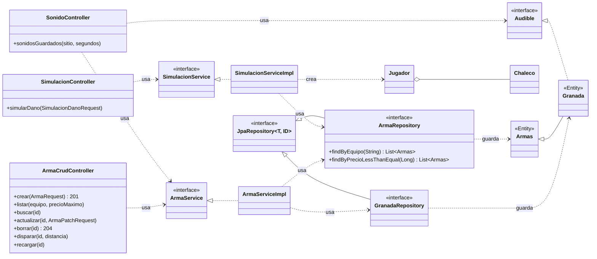
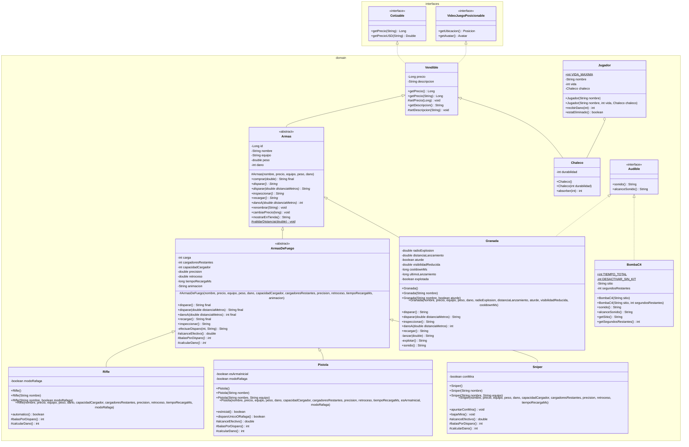

# MK-taller-git-2026 — Modelado de armas de CS2 con Spring Boot (Marcelo Kropff Y43819)

Ejercicio POO-06 (revisión, paquetes, constructores y sobrecarga) de Lenguaje de Programación 3.
Servicio HTTP propio en Spring Boot sobre el modelado de Counter-Strike 2 (opción B), con herencia,
sobreescritura, sobrecarga, ocultamiento de información y paquetes según el template de la cátedra.
Después se sumó el ejercicio de **interfaces**: una capacidad compartida por dos familias distintas
(ver [Interfaz Audible](#interfaz-audible-capacidad-compartida)). En **POO-08** las armas se guardan en
una base **H2** con un CRUD REST en tres capas (ver [POO-08](#poo-08-crud-rest-h2-e-insomnia)).

- Enunciados: [POO-06](https://github.com/alefq/afq-taller-git-2024/blob/main/docs/ejercicio-poo-06-revision-paquetes-constructores-2026-09-30.md) · [POO-08](https://github.com/alefq/afq-taller-git-2024/blob/main/docs/ejercicio-poo-08-crud-h2-insomnia-2026-10-28.md)
- Bitácora de IA: [BITACORA.md](BITACORA.md)
- Especificaciones de POO-06 aplicadas a CS2: [docs/ESPECIFICACIONES.md](docs/ESPECIFICACIONES.md)
- Colección de Insomnia: [insomnia/coleccion-armas-cs2.json](insomnia/coleccion-armas-cs2.json)
- Enlace al commit de la solución POO-06: (https://github.com/Pomona06/MK-taller-git-2026/commit/e7a1c2019b316689e0d4b630e5aee0edf2a06bf2)
- Enlace al commit de la solución POO-08: _(se completa con el hash del merge)_

## Licencia

Apache License 2.0. El texto completo está en [LICENSE](LICENSE).

## Cómo correr

Requiere Java 21.

```bash
./mvnw spring-boot:run
```

Queda escuchando en http://localhost:8080. Los tests se corren con `./mvnw test`.

## POO-08: CRUD REST, H2 e Insomnia

### Las dos reglas

1. **Regla de munición:** un arma de fuego solo dispara si el cargador tiene las balas que pide ese disparo y solo recarga si le queda un cargador de repuesto; si no, el servicio responde 409 y la munición guardada no cambia.
2. **Regla de vida:** la vida de un jugador queda siempre entre 0 y 100 y un jugador eliminado no puede recibir más daño; si se le dispara igual, el servicio responde 409 y el arma no gasta la bala.

### Propiedades de H2

Están en `src/main/resources/application.properties`:

| Propiedad | Qué hace |
|---|---|
| `spring.datasource.url=jdbc:h2:file:./data/armas` | Guarda la base en el archivo `./data/armas.mv.db`, así lo creado sigue ahí después de reiniciar el servicio. |
| `spring.datasource.username=sa` | Usuario de la base (el que se pone en la consola H2). |
| `spring.datasource.password=` | La contraseña está vacía porque la base es local y solo de desarrollo. |
| `spring.jpa.hibernate.ddl-auto=update` | Hibernate crea la tabla `arma` si no existe y la ajusta a las entidades sin borrar los datos. |
| `spring.jpa.open-in-view=false` | La conexión a la base se cierra al terminar el servicio y no queda abierta mientras se arma el JSON. |
| `spring.h2.console.enabled=true` | Habilita la consola web de H2 en `/h2-console` (solo para desarrollo). |

La carpeta `data/` está en `.gitignore`: la base es de cada uno y no se sube al repo. Los tests usan una
base en memoria aparte (`src/test/resources/application.properties`).

### Ver la tabla en la consola H2

1. Arrancá el servicio con `./mvnw spring-boot:run`.
2. Abrí http://localhost:8080/h2-console
3. En **JDBC URL** poné `jdbc:h2:file:./data/armas`, usuario `sa` y contraseña vacía, y tocá **Connect**.
4. Corré `SELECT * FROM ARMA;`. Todas las armas están en esa tabla y la columna `TIPO` dice si la fila es
   `rifle`, `pistola`, `sniper` o `granada`.

### Endpoints de la API

| Método y ruta | Qué hace | Éxito | Errores |
|---|---|---|---|
| `POST /api/armas` | Crea un arma. El JSON lleva `tipo` y los campos que quieras; lo que falte toma el valor del constructor simple de ese tipo. No lleva `id`. | 201 + `id` + `Location` | 400 |
| `GET /api/armas` | Lista lo guardado. Filtros opcionales: `?equipo=CT` o `?precioMaximo=3000`. | 200 | |
| `GET /api/armas/{id}` | Un arma. | 200 | 404 |
| `PATCH /api/armas/{id}` | Cambia `nombre` y/o `precio`. | 200 | 400, 404 |
| `DELETE /api/armas/{id}` | Borra el arma. | 204 | 404 |
| `POST /api/armas/{id}/disparos?distancia=` | Simulación de munición: dispara y guarda la carga. | 200 | 404, 409 |
| `POST /api/armas/{id}/recargas` | Simulación de munición: usa un cargador de repuesto. | 200 | 400 (granada), 404, 409 |
| `POST /api/simulaciones/dano` | Simulación de daño: el arma guardada le dispara a un jugador con o sin chaleco. | 200 | 400, 404, 409 |
| `GET /api/sonidos?sitio=&segundos=` | Las granadas guardadas y una C4, tratadas como `Audible`. | 200 | 400 |

Ejemplo de creación y de simulación:

```bash
curl -X POST localhost:8080/api/armas -H "Content-Type: application/json" \
     -d '{"tipo":"rifle","nombre":"AK-47","modoRafaga":true}'
curl -X POST localhost:8080/api/simulaciones/dano -H "Content-Type: application/json" \
     -d '{"armaId":1,"distancia":10,"jugador":"Enemigo","vida":100,"blindaje":100}'
```

### Simulación de daño: tres clases del modelo

`POST /api/simulaciones/dano` hace participar a tres clases:

1. **El arma guardada** (cualquier hija de `Armas`): `disparar(distancia)` gasta munición y `danoA(distancia)`
   dice cuánto daño hace a esa distancia. Cada rama lo calcula a su modo: un arma de fuego pierde la mitad
   fuera de su alcance y una granada solo daña dentro de su radio.
2. **`Chaleco`** (Kevlar, es un `Vendible` pero no un arma): absorbe la mitad del daño mientras le quede
   durabilidad.
3. **`Jugador`**: `recibirDano()` aplica lo que pasa el chaleco y sostiene la regla de vida.

Todo corre en una transacción. Si una regla falla, la munición que se gastó en memoria no se guarda.

### Jerarquía de excepciones y un handler por tipo

```
RuntimeException
└── JuegoException (abstracta)
    ├── ValorInvalidoException         400  un constructor o mensaje recibió un valor ilegal
    ├── RecursoNoEncontradoException   404  no hay un arma con ese id
    ├── MunicionInsuficienteException  409  regla de munición
    └── JugadorEliminadoException      409  regla de vida
```

`ManejadorErrores` tiene un `@ExceptionHandler` por cada tipo y responde
`{"error": "<mensaje>", "excepcion": "<tipo>"}`. Elegí 409 (*Conflict*) para las dos reglas porque el
pedido está bien formado, pero el estado del arma o del jugador no permite hacerlo; 400 queda para datos
que son ilegales en sí mismos.

### Arquitectura en tres capas



Cómo leer las flechas:

- **Herencia** (`<|--`, línea llena): «es un». `Granada` es un `Armas`, y `ArmaRepository` extiende
  `JpaRepository`.
- **Implementación de interfaz** (`<|..`, línea punteada con triángulo): la clase cumple el protocolo.
  `ArmaServiceImpl` implementa `ArmaService` y `Granada` implementa `Audible`.
- **Uso** (`..>`, línea punteada con flecha): una capa le habla a la otra a través de una interfaz. El
  controller usa el servicio y el servicio usa el repositorio; ninguno conoce la clase concreta que
  Spring arma por detrás.

El diagrama completo de la familia de armas está en [El modelo](#el-modelo).

### Colección de Insomnia

El archivo es `insomnia/coleccion-armas-cs2.json`.

1. Arrancá el servicio con `./mvnw spring-boot:run`.
2. En Insomnia: **Import** → **From File** → elegí `insomnia/coleccion-armas-cs2.json`.
3. El entorno trae `base_url` (`http://localhost:8080`), `armaId` y `sniperId`.
4. Corré las carpetas en orden, de arriba abajo:
   - **0. Servicio vivo:** `GET /`.
   - **1. CRUD (caso feliz):** el primer `POST` crea el AK-47. **Copiá el `id` de la respuesta a `armaId`**
     en el entorno y seguí con `GET` lista, `GET` por id, `PATCH` y el filtro por equipo.
   - **2. Simulaciones e interfaz:** la simulación de daño usa `armaId`. El `POST` del AWP crea un
     francotirador con una sola bala: **copiá su `id` a `sniperId`**. Después se dispara esa bala, se crea
     una flashbang y se piden los sonidos por la interfaz.
   - **3. Errores:** un pedido por cada error. Tres 400, tres 404, dos 409 de munición (el AWP ya no tiene
     balas ni cargadores) y un 409 de jugador eliminado. Después del `POST` ilegal, el `GET` lista muestra
     que no se guardó nada.
   - **4. Borrar:** `DELETE` del AK-47 (204) y el `GET` posterior (404).

Si la base es nueva, los ids son 1 (AK-47) y 2 (AWP), que son los valores que ya trae el entorno.

### Lo que hay que pensar

**Recurso y verbo.** El sustantivo de la API es `armas`: la URL nombra el recurso (`/api/armas/7`) y el
verbo HTTP dice qué hacer (`GET` leer, `POST` crear, `PATCH` cambiar, `DELETE` borrar). Con
`/api/crearRifle` habría que inventar una URL por cada acción y por cada tipo, y el verbo dejaría de
significar algo. Las simulaciones crean un resultado nuevo (un disparo, una recarga), por eso son `POST`
sobre subrecursos: `/api/armas/7/disparos`.

**Identidad.** La clave es `id` (`Long`) y la genera H2 (`GenerationType.IDENTITY`). El JSON de creación no
lo lleva: `ArmaRequest` ni siquiera tiene ese campo. Se devuelve en la respuesta del `POST` y en el
encabezado `Location`.

**Herencia y tablas.** Elegí `SINGLE_TABLE`: toda la familia en la tabla `arma`, con la columna `tipo` como
discriminador. Las cuatro hijas comparten casi todo (nombre, precio, equipo, daño) y casi siempre se listan
juntas en el inventario, así que una sola tabla evita joins. El costo es que las columnas de una hija
quedan en `null` en las filas de otra: una granada no tiene `carga`. En el JSON, `@JsonTypeInfo` agrega la
propiedad `"tipo": "rifle"` (o `granada`, etc.) con el mismo nombre que el discriminador. Para crear,
`ArmaRequest` también lleva `tipo` y el servicio elige el constructor de esa hija.

**Interfaz y repositorio.** `ArmaRepository` es una interfaz y Spring Data genera la clase. El servicio
depende de esa interfaz, no de una clase concreta de acceso a datos, y el controller depende de la
interfaz `ArmaService`. Es lo mismo que con `Audible`: quien pide un mensaje no necesita saber el apellido
de la clase que lo responde. Por eso cambiar la base no toca ni el servicio ni el controller.

**Protocolo del dominio.** `GET /api/sonidos` usa la interfaz `Audible`. En la misma lista aparecen las
granadas guardadas en H2 (familia `Armas`) y una C4 (otra familia, no persistida), y el endpoint solo les
pide `sonido()` y `alcanceSonido()`.

**Ocultamiento.** Las reglas las validan los constructores y los mensajes del dominio (`renombrar`,
`cambiarPrecio`, `disparar`, `recargar`, `recibirDano`). Los campos son privados y no tienen setters
públicos. JPA los carga por reflexión y el JSON nunca se asigna directo a la entidad: llega a un
`ArmaRequest` y el servicio llama al constructor. El constructor sin argumentos que pide JPA es el
constructor simple de POO-06 (`new Rifle()` es un AK-47 legal), así que tampoco deja un objeto a medias.
En Insomnia, el pedido «400 POST con daño negativo» seguido de «GET listar armas» muestra que no quedó
una fila sucia.

**PUT y PATCH.** Elegí `PATCH` y solo para `nombre` y `precio`, que son lo que cambia en la tienda (un
cambio de balance o un skin con otro nombre). Un campo omitido queda como estaba. Lo demás no se edita a
mano: la munición cambia disparando y recargando, y el tipo o el daño definen otra arma.

**DELETE.** Es un borrado físico: la fila desaparece y la respuesta es 204. El dominio no tiene un mensaje
de «descartar», así que no hay un estado intermedio que modelar.

**Si mañana cambiamos H2 por otra base**, se tocan `pom.xml` (el driver) y `application.properties` (URL,
usuario y contraseña). Quedan quietos el dominio, los repositorios, los servicios y los controllers,
porque hablan con interfaces y con anotaciones JPA estándar.

## Endpoints en memoria (POO-06 y POO-07)

| Método y ruta | Qué hace |
|---|---|
| `GET /` | Confirma que el servicio está vivo y lista los endpoints. |
| `GET /armas/crear?tipo=...` | Construye el arma con el **constructor completo**. Todos los atributos se pueden pisar por query string (`nombre`, `precio`, `equipo`, `dano`, `modoRafaga`, `aturde`, etc.); si no mandás, usa unos defaults razonables. |
| `GET /armas/crear-simple?tipo=...` | Construye el arma con los **constructores sobrecargados**: sin argumentos, `(nombre)` o `(nombre, equipo / modoRafaga / aturde)` según lo que venga en la URL. El JSON dice qué firma se usó. |
| `GET /armas/comparar` | Arma una `List<Armas>` con un Rifle, una Pistola, un Sniper y una Granada y le pide a cada una `disparar()`. |
| `GET /sonidos?sitio=A&segundos=40` | Arma una `List<Audible>` con una HE, una flashbang y una C4, y le pide a cada una `sonido()` y `alcanceSonido()` a través de la interfaz. `sitio` (A o B) y `segundos` (0 a 40) son opcionales y configuran la C4. |

`tipo` puede ser `rifle`, `pistola`, `sniper` o `granada`. En los tres endpoints de armas, el parámetro
opcional `distancia` hace que se use la sobrecarga `disparar(double)` en lugar de `disparar()`.

Las respuestas de `crear` y `crear-simple` devuelven un JSON con: el tipo concreto, el constructor usado,
cómo se ve en la tienda, qué pasa si la comprás, qué mensaje de disparo se usó, qué pasa si disparás y la
animación de inspección.

Si un valor rompe una regla del dominio, la clase lo rechaza en el constructor y el servicio responde
**400** con el mensaje de la clase: `{"error": "...", "excepcion": "ValorInvalidoException"}`.

### Ejemplos probados

```bash
curl "http://localhost:8080/"
curl "http://localhost:8080/armas/crear?tipo=rifle&nombre=AK-47&modoRafaga=true"
curl "http://localhost:8080/armas/crear?tipo=sniper&nombre=AWP&dano=115"
curl "http://localhost:8080/armas/crear-simple?tipo=sniper"
curl "http://localhost:8080/armas/crear-simple?tipo=granada&nombre=Flashbang&aturde=true"
curl "http://localhost:8080/armas/crear-simple?tipo=pistola&nombre=USP-S&equipo=CT&distancia=25"
curl "http://localhost:8080/armas/comparar"
curl "http://localhost:8080/armas/comparar?distancia=25"
curl "http://localhost:8080/sonidos?sitio=B&segundos=7"
curl "http://localhost:8080/sonidos?sitio=C"             # 400: sitio inválido
curl "http://localhost:8080/armas/crear?tipo=rifle&dano=-5"      # 400: daño negativo
curl "http://localhost:8080/armas/crear?tipo=rifle&equipo=XYZ"   # 400: equipo inválido
```

Respuesta de `GET /armas/comparar` (el mismo mensaje, cuatro implementaciones distintas):

```json
[
  {"tipoConcreto":"Rifle","nombre":"AK-47","disparo":"AK-47 disparó (1 balas, precisión 0.75) causando 36 de daño. Quedan 29/30 balas."},
  {"tipoConcreto":"Pistola","nombre":"Glock-18","disparo":"Glock-18 disparó (1 balas, precisión 0.6) causando 30 de daño. Quedan 19/20 balas."},
  {"tipoConcreto":"Sniper","nombre":"AWP","disparo":"AWP disparó (1 balas, precisión 0.95) causando 46 de daño. Quedan 4/5 balas."},
  {"tipoConcreto":"Granada","nombre":"HE","disparo":"Lanzada a 20.0m. HE explotó (radio 5.0m, causa 57 de daño)"}
]
```

## Paquetes

La organización sigue el template [lp3-template-tp](https://github.com/alefq/lp3-template-tp/tree/main/src/main/java/py/edu/uc/lp3):

```
src/main/java/py/edu/uc/lp3/
├── Application.java              solo arranca Spring Boot
├── domain/                       reglas del juego
│   ├── Vendible.java             @MappedSuperclass
│   ├── Armas.java                @Entity abstracta (tabla arma, SINGLE_TABLE)
│   ├── ArmasDeFuego.java         @Entity abstracta
│   ├── Rifle.java · Pistola.java · Sniper.java · Granada.java   @Entity
│   ├── Audible.java              interfaz: sonido() y default alcanceSonido()
│   ├── BombaC4.java              otra familia: implementa Audible
│   ├── Jugador.java              simulación de daño: regla de vida
│   └── Chaleco.java              Kevlar: absorbe daño
├── exceptions/                   JuegoException y sus cuatro hijas
├── interfaces/                   Cotizable, VideoJuegoPosicionable, Avatar, Posicion
├── repository/                   interfaces de Spring Data
│   ├── ArmaRepository.java
│   └── GranadaRepository.java
├── service/                      capa de negocio (interfaces)
│   ├── ArmaService.java · SimulacionService.java
│   ├── dto/                      ArmaRequest, ArmaPatchRequest, SimulacionDanoRequest, respuestas
│   └── impl/                     ArmaServiceImpl, SimulacionServiceImpl
└── rest/controller/              entrada HTTP
    ├── IndexController.java      GET /
    ├── ArmaCrudController.java   /api/armas (CRUD y munición)
    ├── SimulacionController.java /api/simulaciones/dano
    ├── ArmaController.java       /armas/crear, /armas/crear-simple, /armas/comparar
    ├── SonidoController.java     /sonidos y /api/sonidos
    └── ManejadorErrores.java     un @ExceptionHandler por tipo de excepción
```

El dominio no conoce nada de HTTP ni de la base, los repositorios son solo interfaces y los controllers no
tienen reglas del juego: traducen HTTP, le hablan al servicio y devuelven el error de cada excepción.

## El modelo

Acá cambió bastante respecto a la primera versión subida. Me di cuenta que el esqueleto real que veníamos usando del Zulip no era el que había armado yo, sino uno que ya venía con parte del código puesto. Rifle, Pistola, Sniper y Granada no estaban, eso le agregué yo.



Convención del diagrama: `-` privado, `#` protegido, `+` público, `*` abstracto, `$` estático.

## Interfaz Audible (capacidad compartida)

**La capacidad:** sonar en la partida. En CS2 el sonido es información: una HE o una flash se oyen
cerca, y el bip de la C4 se oye desde todo el mapa y se acelera cuando queda poco tiempo.

**Dos familias distintas:**
- `Granada` pertenece a la familia `Vendible → Armas`: se compra y se lanza.
- `BombaC4` no es un arma ni se vende, es el objetivo de la ronda: es otra familia.

No tiene sentido una clase padre común solo para «sonar». Por eso la capacidad es una `interface` en
`domain`, y cada clase la implementa sin cambiar su herencia: `Granada extends Armas implements Audible`.

```java
public interface Audible {
    String sonido();                       // cada clase lo resuelve a su modo
    default String alcanceSonido() {       // comportamiento por defecto
        return "se escucha solo cerca";
    }
}
```

| Clase | `sonido()` | `alcanceSonido()` |
|---|---|---|
| `Granada` | HE: «¡BOOM! grave que retumba». Flashbang: «¡pum! seco y después un pitido agudo en los oídos». | Usa el **default**: «se escucha solo cerca» |
| `BombaC4` | El bip se acelera: «bip... bip...» con más de 10 s, «bip-bip-bip-bip» cuando sin kit ya no da el tiempo, «¡BOOM!» en 0 s. | **Reemplaza el default**: «se escucha en todo el mapa» |

**Servicio REST:** `SonidoController` arma una `List<Audible>` y le pide `sonido()` y `alcanceSonido()`
a cada elemento a través del tipo de la interfaz, sin preguntar a qué familia pertenece:

```bash
curl "http://localhost:8080/sonidos?sitio=B&segundos=7"
```

```json
[
  {"tipoConcreto":"Granada","sonido":"HE: ¡BOOM! grave que retumba","alcance":"se escucha solo cerca"},
  {"tipoConcreto":"Granada","sonido":"Flashbang: ¡pum! seco y después un pitido agudo en los oídos","alcance":"se escucha solo cerca"},
  {"tipoConcreto":"BombaC4","sonido":"bip-bip-bip-bip: quedan 7 s en el sitio B, sin kit ya no llega a desactivarse","alcance":"se escucha en todo el mapa"}
]
```

La C4 también cuida su estado: el constructor rechaza un sitio distinto de A o B y segundos fuera de 0 a
40, y el servicio responde 400 con el mensaje de la clase.

## Sobrecarga y sobreescritura

### Sobreescritura (misma firma en la clase hija, implementación propia)

| Método | Dónde se declara | Quién lo sobreescribe y cómo |
|---|---|---|
| `disparar()` | **abstracto** en `Armas` | `ArmasDeFuego`: gasta balas del cargador y calcula daño. `Granada`: se lanza y explota (daño o aturdimiento), con cooldown. |
| `disparar(double)` | **abstracto** en `Armas` | `ArmasDeFuego`: fuera del alcance efectivo el daño baja a la mitad. `Granada`: si la distancia supera el máximo, no llega. |
| `inspeccionar()` | **abstracto** en `Armas` | `ArmasDeFuego` muestra su animación y retroceso; `Granada` avisa si ya fue usada. |
| `balasPorDisparo()` | **abstracto** en `ArmasDeFuego` | `Rifle` y `Pistola`: 3 en ráfaga, 1 si no. `Sniper`: siempre 1. |
| `calcularDano()` | **abstracto** en `ArmasDeFuego` | `Rifle`: 80 % en ráfaga. `Pistola`: 70 % en ráfaga. `Sniper`: 40 % sin mira. |
| `alcanceEfectivo()` | concreto en `ArmasDeFuego` (30 m) | `Pistola`: 15 m. `Sniper`: 200 m. `Rifle` usa el del padre. |

El método abstracto principal es `disparar()`: es lo que **toda** arma tiene que saber hacer y `Armas` no
puede resolverlo, porque un arma de fuego y una granada responden distinto. Quien usa el modelo
(`ArmaController`) habla siempre con `Armas`; `GET /armas/comparar` lo muestra con una `List<Armas>`.

### Sobrecarga (misma clase, mismo nombre, otra lista de argumentos)

| Qué | Dónde | Firmas |
|---|---|---|
| Mensaje del dominio `disparar` | `Armas` (y sus implementaciones en `ArmasDeFuego` y `Granada`) | `disparar()` y `disparar(double distanciaMetros)` |
| Constructores | `Rifle` | `Rifle()`, `Rifle(String)`, `Rifle(String, boolean)`, completo |
| Constructores | `Pistola` | `Pistola()`, `Pistola(String)`, `Pistola(String, String)`, completo |
| Constructores | `Sniper` | `Sniper()`, `Sniper(String)`, `Sniper(String, String)`, completo |
| Constructores | `Granada` | `Granada()`, `Granada(String)`, `Granada(String, boolean)`, completo |
| `getPrecio` | `Vendible` | `getPrecio()` y `getPrecio(String)` (esta viene de `Cotizable`) |

Los constructores simples encadenan con `this(...)` hasta el constructor completo, que es el **único** que
llama a `super(...)`. Así las validaciones de `Armas` y `ArmasDeFuego` corren para cualquier firma y ninguna
deja el objeto en un estado ilegal. Por ejemplo, `new Sniper()` es un AWP de 4750 $ con 5 balas por
cargador, y `new Granada("Flashbang", true)` es una flash que aturde en vez de hacer daño.

### Cómo se distingue una de la otra

- **Sobrecarga**: misma clase, mismo nombre, **distintos parámetros**. La elige el **compilador** mirando
  los argumentos: `arma.disparar()` contra `arma.disparar(25.0)`.
- **Sobreescritura**: clase hija, **misma firma** que el padre (`@Override`). La elige la **JVM al
  ejecutar** mirando el tipo real del objeto: `arma.disparar()` hace cosas distintas si `arma` es un
  `Rifle` o una `Granada`, aunque la variable sea de tipo `Armas`.

## Por qué es así

Vendible ya venía con precio y descripcion resueltos, no hacía falta duplicar eso en Armas. Lo que sí le cambié en esta revisión fue la visibilidad: los campos estaban sin modificador y `setPrecio()` era público, así que cualquier clase (por ejemplo el controller) podía hacer `arma.setPrecio(-500L)`. Ahora los campos son private, los setters protected y `setPrecio()` rechaza nulos y negativos.

Armas estaba vacía. La completé con lo común a cualquier arma: nombre, equipo, peso, daño. Y con lo que pedía la consigna, que el inventario pueda tratar cualquier arma igual (pedirle que dispare, que se muestre en la tienda, que se compre) sin fijarse de qué tipo es. Por eso disparar() está declarado como abstracto directamente en Armas, no en ArmasDeFuego - así una Granada también responde a disparar() aunque por dentro lo que hace es lanzarse y explotar (delega en un lanzar() privado).

ArmasDeFuego traía un solo campo, carga, y estaba puesto como protected. Lo cambié a private, porque protected igual deja que una subclase lo modifique directo sin pasar por recargar(), y eso rompe lo de que la munición no se pise desde afuera. Lo que sí costó pensar fue cómo evitar que Rifle, Pistola y Sniper terminen repitiendo el mismo disparar() tres veces con pequeños cambios. Terminé poniendo disparar() y recargar() como final en ArmasDeFuego, se escriben una sola vez ahí y cada subclase solo sobreescribe dos métodos pequeños: balasPorDisparo() (cuántas balas gasta un tiro) y calcularDano() (cómo calcula el daño). Rifle y Pistola en modo ráfaga gastan 3 balas por vez, Sniper siempre gasta 1 pero calcula el daño distinto según si tenés la mira puesta o no. Las dos versiones de disparar (con y sin distancia) gastan munición por el mismo método privado, efectuarDisparo().

Un cambio que hice durante la realizacion, al principio solo Rifle tenía lo de ráfaga/automático. Pero analizando mejor debido a innumerables horas de experiencia en ese juegazo recordé que las pistolas CZ también puede disparar en ráfaga, así que le agregué el mismo campo modoRafaga a Pistola y reutilicé el mismo método gancho en vez de inventar uno nuevo, si no, iba a terminar duplicando lógica entre las dos.

Todo lo que tiene que ver con munición (carga, cargadoresRestantes) y con el cooldown de la granada (ultimoLanzamiento, cooldownMs) lo dejé private. La idea es que nadie de afuera pueda, por ejemplo, resetear el cooldown para hacer explotar una granada antes de tiempo, ni cargar balas de la nada sin pasar por recargar().

Las reglas se validan en los constructores: nombre no vacío, equipo `CT` o `TT`, precio, peso y daño no negativos, capacidad del cargador mayor a 0, precisión entre 0 y 1, visibilidad reducida entre 0 y 100, etc. Si un valor no cumple, la clase lanza `IllegalArgumentException` y el objeto no llega a existir.

Una cosa que agregué y que no estaba en el esqueleto original, el atributo nombre en Armas. Lo necesitaba porque si no, comprar(), inspeccionar() y el JSON que devuelve el controller no tienen forma de decir de qué arma están hablando.

mostrarEnTienda() deje como método normal no abstracto en Armas, porque con nombre, precio, equipo y peso alcanza para mostrarla en la tienda - no hacía falta que cada subclase lo reescriba.

Granada tampoco existía, la agregué extendiendo Armas directamente y no ArmasDeFuego, porque no dispara balas ni se recarga.

### ¿Qué pasa si el controller asigna a mano la vida o la munición?

No puede: `carga`, `cargadoresRestantes` y el cooldown son private y no tienen setter, y `setPrecio()` es protected. La munición solo cambia con `disparar()` y `recargar()`. Si el controller manda un valor inválido al constructor, la clase lo rechaza y `ManejadorErrores` responde 400.

## Controller

ArmaController recibe tipo por query param y ahí sí tiene que usar un
switch para saber qué constructor llamar ya eso no se puede evitar porque construir
el objeto correcto requiere saber el tipo. Pero una vez que la instancia
ya existe, todo el resto del método la trata como Armas, llama
.mostrarEnTienda(), .comprar(), .disparar(), .inspeccionar() sin
ningún if ni instanceof de por medio.

## Repositorio

https://github.com/Pomona06/MK-taller-git-2026
